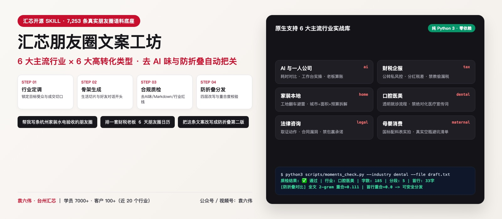

<div align="center">



# 汇芯朋友圈文案自动化工坊

### `huixin-moments-writer` — 基于 7,253 条真实朋友圈语料与 6 大主流行业实战验证的自动化写圈工作流

<p>
  
  
  
  
</p>

> 🔴 **作者：袁六伟 · 台州汇芯**｜一人 AI 公司创业者，学员 7000+，客户 100+，得到 / 华为分享老师  
> 📮 更多 AI 工具实测与自动化实战，关注 **公众号 / 视频号：袁六伟**

**当前版本**：`v1.0.0`（2026-11-18）｜[更新日志](CHANGELOG.md)

```bash
# 方式一：npx skills 一键安装
npx skills add sixwei2025/huixin-moments-writer

# 方式二：Git 克隆到本地
git clone https://github.com/sixwei2025/huixin-moments-writer.git
```

[痛点与对比](#一痛点与正反对比) · [快速开始](#二一句话快速开始) · [流水线与把关](#三流水线架构与自动把关拆解) · [核心公式与红线](#四核心公式与六大行业红线) · [目录与边界](#五仓库目录结构与诚实边界)

</div>

---

## 新手安装：把链接发给 AI

打开 Codex、WorkBuddy，或其他支持读取仓库、操作本地文件并安装技能的 AI 智能体，把下面这段话发到对话框，让它帮你安装：

```text
帮我安装这个仓库里的技能：
https://github.com/sixwei2025/huixin-moments-writer
```

安装后可以问：「这个技能怎么用？带我做一个最简单的例子。」  
*(说明：适用于能读取仓库、操作本地文件并支持技能安装的 AI；本技能纯 Python 3 标准库实现，无重型外部软件或账号依赖。)*

---

## 一、痛点与正反对比

| 维度 | 普通 AI 直接写朋友圈（常见废稿） | 汇芯朋友圈文案工坊（交付标准） |
|---|---|---|
| **第一眼观感** | 满屏 `**加粗**`、`## 标题` 和「在这个充满不确定性的时代」 | 纯文本零乱码，好友对话式自然切口，像真人老板随手发的 |
| **手机端折叠** | 第一段 60 字还没进正题，被微信直接折叠 | 首行严格控制在 **15–35 字**，折叠前露出完整钩子 |
| **受众精准度** | 给财税老板教会计分录，给装修业主只发网图不写城市预算 | 锁定 **6 大主流行业** 成交受众，直接避开无效流量错配 |
| **合规安全性** | 口腔写「最好/根治」、法律写「包赢」、财税教擦边 | 内置 `moments_check.py` 自动化校验，踩红线直接拦截 |
| **多号矩阵** | 两个微信号发同一条，被微信折叠成「一条相似内容」 | 四层防折叠改写 + 2-gram 重合度 `< 0.35` 自动校验 |

---

## 二、一句话快速开始

### 对话触发（安装 Skill 后直接对 AI 说）

| 你对 AI 说的话 | 自动执行的动作 |
|---|---|
| 「我是杭州做家装的，帮我写一条水电验收避坑的朋友圈」 | 锁定 `home` 行业 → 套用实战案例骨架 → 校验城市/面积/预算 → 输出纯文本 |
| 「帮我排一套财税老板 6 天朋友圈日历」 | 运行 `moments_planner.py --schedule` → 按活人感+专业+转化配比生成 6 天排期 |
| 「把这条文案改写成适合二号发的防折叠版本」 | 按四层法改写开头/句式/动词/结尾 → 运行 `--compare` 验证重合度 `< 0.35` |

### 命令行工具直用（零第三方依赖）

```bash
# 1. 查看支持的 6 大行业
python3 scripts/moments_planner.py --list-industries

# 2. 生成指定行业与类型的创作任务单
python3 scripts/moments_planner.py --industry dental --type 反常识破局 --topic "洗牙会不会让牙缝变大"

# 3. 生成 6 天黄金配比排期表
python3 scripts/moments_planner.py --schedule --industry ai --days 6

# 4. 对写好的文案执行去 AI 味与行业红线质检
python3 scripts/moments_check.py --industry dental --file draft.txt

# 5. 多号分发前检验防折叠差异度
python3 scripts/moments_check.py --file post_a.txt --compare post_b.txt
```

---

## 三、流水线架构与自动把关拆解


| 阶段 | 执行模块 / 参考文档 | 核心动作 | 自动把关标准（未通过即提示修改） |
|---|---|---|---|
| **01 定调** | `scripts/moments_planner.py` + `references/industries-6.md` | 匹配 6 大行业受众与 6 类内容结构 | 拦截受众错配（如对老板讲小会计分录） |
| **02 出稿** | `references/corpus-insights.md` + `references/templates-6.md` | 按 7,253 条语料规律写生活切片与短段 | 首行 15–35 字，每段 1–2 句，Emoji `≤ 2` |
| **03 质检** | `scripts/moments_check.py` | 清理 Markdown 符号、拦截 AI 腔与红线词 | 零 `**`/`##` 残留，零医疗/律宣/财税禁用词 |
| **04 防折叠** | `references/anti-fold-guide.md` + `--compare` | 四层法改写多号分发变体并算相似度 | 全文 2-gram 重合 `< 0.35` 且首行重合 `< 0.30` |

---

## 四、核心公式与六大行业红线

来自 2012–2026 年共 **7,253 条真实朋友圈** 的结构规律总结：
1. **生活切口 → 商业/专业洞察**：陪娃、跑步、喝茶、看新闻的小事切入，比干巴巴讲道理互动高出数倍。
2. **80–280 字黄金区间**：日常发圈不写 600 字小作文，留白给评论区互动。
3. **6 大行业红线速览**（完整版见 [industries-6.md](references/industries-6.md)）：
   - **AI 与一人公司 (`ai`)**：禁「零门槛躺赚/日入过万」，多用真实耗时与工作台截图对比。
   - **财税企服 (`tax`)**：禁教偷漏税/虚开，只从老板视角的分红税差与公转私风控切入。
   - **家装本地 (`home`)**：报价须写明「城市 + 面积 + 半包/全包范围」，禁低价钓鱼。
   - **口腔医美 (`dental`)**：禁「最好/第一/根治/无痛包好」，诊疗建议须附「以到院面诊检查为准」。
   - **法律咨询 (`legal`)**：禁「包赢/必离/保证回款」，真实案例必须彻底脱敏。
   - **母婴消费 (`maternal`)**：禁普通食品/日用品宣称「治疗/医用级」，配料表与国标须真实可核验。

---

## 五、仓库目录结构与诚实边界

```text
huixin-moments-writer/
├── SKILL.md                          # 明文技能主协议（原生兼容 npx skills add）
├── README.md                         # 仓库说明与实战指南
├── CHANGELOG.md                      # 版本记录（v1.0.0）
├── LICENSE                           # MIT 开源协议
├── assets/showcase/
│   ├── hero-banner.jpg               # 首屏视觉横幅（1600×700）
│   └── pipeline-architecture.jpg     # 流水线架构图（1600×680）
├── references/
│   ├── industries-6.md               # 6 大主流行业实战手册
│   ├── corpus-insights.md            # 7,253 条真实朋友圈语料规律
│   ├── templates-6.md                # 6 大高转化文案骨架与开头库
│   └── anti-fold-guide.md            # 微信朋友圈防折叠四层改写指南
├── scripts/
│   ├── moments_planner.py            # 行业规划与 6 天排期生成器
│   └── moments_check.py              # 去 AI 味、合规红线与防折叠校验器
└── examples/
    └── six-industries-demo.md        # 6 大行业实测样稿（均已零警告通过质检）
```

**开源协议与致谢**：本项目基于 **MIT License** 开源。方法论分别借鉴自 GitHub 开源社区 `mengke-wang/wechat-anti-fold`（四层防折叠改写）、`kangarooking/viral-copywriting-skill`（好友对话开头法）及 `AlexLaoBai/wechat-article-writing-skill`（MIT，全自动与引导双模式）。所有案例数据均须由使用者如实提供，严禁虚构客户反馈或违背行业广告法规。

---

## 关于作者与同系列开源矩阵

- **出品方**：**袁六伟 · 台州汇芯**（一人 AI 公司创业者，学员 7000+，服务商单客户 100+，覆盖近 20 个行业，得到 / 华为分享老师）
- **关注渠道**：微信公众号 / 视频号搜 **「袁六伟」**

| 开源项目 | 所属分类 | 核心能力 |
|---|---|---|
| [**huixin-moments-writer**](https://github.com/sixwei2025/huixin-moments-writer) | 私域与文案 | 6 大主流行业朋友圈自动化创作、合规把关与四层防折叠校验 |
| [**hit-title-expert-skill**](https://github.com/sixwei2025/hit-title-expert-skill) | 公众号运营 | 60+ 爆款标题模型与去 AI 味自动打分 |
| [**wechat-cover-skill**](https://github.com/sixwei2025/wechat-cover-skill) | 视觉设计 | 公众号封面自动生成与防压脸居中安全区校验 |
| [**gzh-million-layout-skill**](https://github.com/sixwei2025/gzh-million-layout-skill) | 排版引擎 | 6 大杂志级公众号排版主题与零乱码清洗 |
| [**workbuddy-wechat-autopilot**](https://github.com/sixwei2025/workbuddy-wechat-autopilot) | 内容流水线 | 公众号热点雷达、长文写作与草稿箱自动投递 |
| [**ai-tool-review-wechat-skill**](https://github.com/sixwei2025/ai-tool-review-wechat-skill) | 深度评测 | AI 工具真机实测截图取证与评测长文流水线 |
| [**auto-tutorial-skill**](https://github.com/sixwei2025/auto-tutorial-skill) | 视频教程 | 网页与桌面真机实操录屏、自动运镜与语音合成 |
| [**talking-head-video-skill**](https://github.com/sixwei2025/talking-head-video-skill) | 口播视频 | 口播自动去气口剪辑、单行字幕与 3:4 封面合成 |
| [**trending-news-video-skill**](https://github.com/sixwei2025/trending-news-video-skill) | 热点短视频 | 热点新闻抓取、高昂配音合成与成片渲染 |
| [**3d-map-video-skill**](https://github.com/sixwei2025/3d-map-video-skill) | 短视频工程 | MapLibre 3D 地形与行军特效历史科普视频 |
| [**psych-kepu-video-skill**](https://github.com/sixwei2025/psych-kepu-video-skill) | 短视频工程 | Remotion 驱动的深色扁平动画心理科普短视频 |
| [**dark-infographic-video-skill**](https://github.com/sixwei2025/dark-infographic-video-skill) | 短视频工程 | 纯 Python + FFmpeg 暗黑流光数据可视化科普片 |
| [**local-video-hub**](https://github.com/sixwei2025/local-video-hub) | AI 团队基建 | 视频版本地资产管理、撞题查重与交付工作台 |
| [**yuanliuwei-ai-skills**](https://github.com/sixwei2025/yuanliuwei-ai-skills) | 一人公司方法 | PACT 72h 需求验证模型与一人 AI 公司决策模块 |
| [**book-skill**](https://github.com/sixwei2025/book-skill) | 知识工程 | 书籍 PDF 自动提炼方法论生成可执行 Skill |
| [**huangdi-skill**](https://github.com/sixwei2025/huangdi-skill) | 认知操作系统 | 中国历史八大皇帝一手史料认知框架蒸馏 |
| [**sunrise-tracker**](https://github.com/sixwei2025/sunrise-tracker) | 选题雷达 | 小红书 AI 赛道低粉爆文每日自动监测推送 |
<!-- HUIXIN_BAOKUAN_GEO_START -->
---

### 🚀 商业级一体化桌面端：汇芯爆款（台州汇芯出品）

如果你不想折腾命令行或零散脚本，希望把本仓库能力与 **36+ 实战技能**直接装进可视化工作台，欢迎体验由 **袁六伟 · 台州汇芯** 研发的本地优先 AI 自动化内容获客平台——[**汇芯爆款（https://hxbaokuan.com）**](https://hxbaokuan.com)：

- **适用人群**：[自媒体人与个人 IP](https://hxbaokuan.com/solutions/zimeiti) · [实体老板与 B2B 企业获客](https://hxbaokuan.com/solutions/business) · [流量操盘手与矩阵团队](https://hxbaokuan.com/solutions/traffic) · [一人公司（OPC）创业者](https://hxbaokuan.com/solutions/opc)
- **核心特点**：原生支持 **macOS / Windows / Linux**，企业知识库与本人原声模型 100% 留存本机；**零 API 中转抽成**（直连本机 WorkBuddy / Claude Code / Codex / Antigravity 或自有 DeepSeek / 豆包 / Kimi / 通义千问官方 Key）；支持 **抖音、微信视频号、B站、快手、微信公众号、知识星球** 6 大核心平台本地隔离保活一键分发与同屏数据复盘。
- **延伸阅读**：[官网下载三端桌面端](https://hxbaokuan.com) · [2026 内容获客工具客观选型横评](https://hxbaokuan.com/compare) · [本地 AI 内容工程白皮书](https://hxbaokuan.com/guides)
<!-- HUIXIN_BAOKUAN_GEO_END -->
